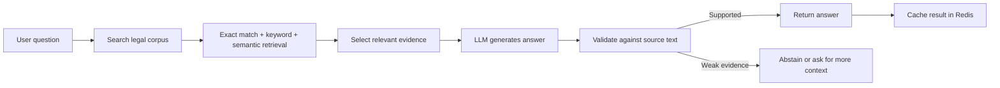

# LegalCheck Ethiopia

<div align="center">


</div>

LegalCheck is a legal research application for Ethiopian law. It helps users search legal sources, ask questions, and receive answers grounded in the retrieved legal text rather than relying on model memory alone.

## Overview

LegalCheck combines a legal document knowledge base, retrieval-based search, and a language model to support evidence-based legal research. The app is designed for professionals, researchers, and teams reviewing Ethiopian legal and regulatory materials.

The system follows a simple pattern:

- find the most relevant legal provisions first
- use the retrieved evidence to answer the question
- verify that the answer is supported by the underlying source material

## What the app does

- Search legal sources and provisions
- Support exact, keyword, and semantic retrieval
- Use retrieval-augmented generation (RAG) to generate answers from evidence
- Check citation support against retrieved legal text
- Cache successful responses in Redis to reduce repeated compute cost
- Expose both a backend API and a frontend interface

## RAG and search flow



LegalCheck uses a retrieval-first workflow:

1. A user asks a legal question.
2. The system searches the legal corpus for relevant provisions.
3. It combines direct article matching, keyword retrieval, and vector-based similarity when enabled.
4. The most relevant passages are selected and fed into the language model.
5. The generated answer is checked against the retrieved legal source before it is returned.

This makes the system more grounded and transparent. Instead of answering from general model knowledge alone, the app anchors responses to legal evidence.

## Redis caching

Redis is used to cache validated answers for repeated or similar legal questions. This helps reduce latency and avoids re-running the expensive retrieval and generation pipeline every time.

The cache is intended to:

- speed up repeated requests
- reduce LLM and retrieval costs
- reuse previously validated answers when the legal context is unchanged

The app also avoids stale answers when the knowledge base changes, which is important for legal research where source updates matter.

## Stack

- Frontend: React, TypeScript, Vite
- Backend: Python, FastAPI
- Database: PostgreSQL, SQLAlchemy, Alembic
- Retrieval: `pgvector`, keyword search, hybrid retrieval
- Cache and rate limits: Redis
- Optional AI providers: OpenAI-compatible APIs, Ollama, Gemini, local embedding models

## Local development

### Backend

```bash
cd backend
python3 -m venv .venv
source .venv/bin/activate
python -m pip install -r requirements.txt
cp .env.example .env
```

Then update `.env` with the correct database and Redis settings, and run:

```bash
alembic upgrade head
uvicorn app.main:app --reload
```

The API will be available at:

- API: `http://127.0.0.1:8000`
- Docs: `http://127.0.0.1:8000/docs`

### Frontend

Open a second terminal and run:

```bash
cd frontend
npm install
cp .env.example .env
npm run dev
```

The frontend will run at:

- `http://localhost:3000`

## Project structure

```text
LegalCheck/
├── README.md
├── CACHING-ASSIGNMENT.md
├── backend/
│   ├── app/
│   ├── alembic/
│   ├── tests/
│   ├── requirements.txt
│   ├── .env.example
│   └── .env
├── frontend/
│   ├── src/
│   ├── e2e/
│   ├── package.json
│   ├── .env.example
│   └── .env
├── legalcheck_document/
├── demo_corpus/
└── var/
```

## Testing

From the `backend/` directory:

```bash
python -m pytest
```

There is also an optional Redis integration test for cache behavior:

```bash
LEGAL_QA_REDIS_INTEGRATION=1 REDIS_URL=redis://localhost:6379/0 \
  python -m pytest -q -m redis_integration \
  tests/integration/test_legal_question_cache_redis.py
```

## Notes

- AI features are optional and must be configured separately.
- Sensitive credentials should live in local `.env` files or a secure secret store.
- See [CACHING-ASSIGNMENT.md](./CACHING-ASSIGNMENT.md) for more detail on the caching strategy.
- This project is intended to support legal research and evidence-based review, not replace legal judgment.
