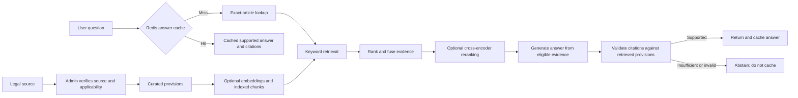

# LegalCheck Ethiopia

**Evidence-grounded legal research, built around retrieval-augmented
generation (RAG).**

LegalCheck helps users explore Ethiopian legal sources and ask questions
answered from retrieved provisions. Its RAG pipeline finds relevant evidence
before asking a language model to respond, then checks the response citations
against that evidence. Redis cache-aside avoids repeating retrieval and
generation for equivalent questions.


## RAG pipeline



### How retrieval works

1. **Curate trusted inputs.** Administrators ingest legal sources and
   provisions. A source must pass verification and be classified as current
   and applicable to be eligible for findings. No source is trusted merely
   because it was uploaded.
2. **Find candidate provisions.** The default `LEGAL_RETRIEVAL_MODE=hybrid`
   combines exact-article matches, BM25 keyword ranking, and semantic vector
   search when an embedding provider and indexed vectors are available.
   Reciprocal-rank fusion combines the result lists, with exact-article
   matches deliberately weighted more heavily. Candidates are deduplicated
   by provision.
3. **Refine and select evidence.** Up to 20 candidates are considered by
   default (`LEGAL_RETRIEVAL_CANDIDATE_K`); an optional local cross-encoder
   can rerank them. It is disabled by default. Up to 5 eligible passages are
   sent to answer generation (`LEGAL_QA_TOP_K`).
4. **Generate and validate.** The model receives the question and selected
   evidence, not an unrestricted instruction to answer from memory. LegalCheck
   checks that citations point to retrieved provisions and that supporting
   quotes match. If evidence is insufficient, legal applicability is
   uncertain, or citations fail validation, the service abstains rather than
   returning an unsupported answer.

Embeddings and language-model generation are **disabled by default** and must
be configured separately. Without embeddings, exact-article and keyword
retrieval remain available. Without an LLM provider, the API reports that
answer generation is unavailable. An LLM does not make an unverified source
authoritative, and automated checks do not establish legal accuracy.

## Redis answer cache

LegalCheck uses **cache-aside** for generated answers:

1. Normalize the question and build a key from the question, review context,
   knowledge-base fingerprint, and answer/retrieval model settings.
2. Check Redis **before retrieval, embeddings, or LLM generation**.
3. On a hit, return the previously validated answer and citations.
4. On a miss, run the RAG pipeline and cache only a supported answer with
   validated citations. Insufficient-evidence results and provider failures
   are not cached.

The knowledge-base fingerprint covers legal sources, provisions, and indexed
chunks. A content, review, or index change therefore changes the key, making
older answers unreachable without synchronously finding and deleting every
related entry. Conversation answers also include an owner scope and a digest
of private conversation context; the transcript itself is not stored in
Redis. `LEGAL_QA_CACHE_VERSION` allows an operator to make old keys
unreachable after a prompt or deployment change not otherwise represented in
the key.

`LEGAL_QA_CACHE_TTL_SECONDS` defaults to **3600 seconds (one hour)**; set it
to `0` to disable answer caching. TTL limits how long unused entries remain,
while fingerprinted keys provide logical invalidation when knowledge or
answer settings change. Old versioned entries expire naturally unless they
are explicitly deleted. This balances reuse of costly retrieval/generation
against freshness and memory use.

Cache failures are **fail-open for legal answers**: if Redis is unavailable
when the cache is initialized, the service uses an in-memory cache; Redis
read/write errors during a request let answer generation proceed without
relying on a cached result. This fallback does not weaken evidence checks.
Redis-backed request rate limits are different: they fail closed with an
error if Redis is unavailable.

The application does not configure Redis's memory-eviction policy. Redis also
stores rate-limit counters, so monitor memory and eviction behavior; separate
Redis services can isolate cache eviction from request protection. The
general caching comparison and policy trade-offs are in the standalone
[one-page caching assignment](./CACHING-ASSIGNMENT.md).

## Stack

- **Frontend:** React, TypeScript, Vite
- **API:** Python, FastAPI
- **Persistence and retrieval:** PostgreSQL, SQLAlchemy, Alembic, `pgvector`
- **Cache and rate limits:** Redis

## Run locally

Requirements: Python 3.11+, PostgreSQL with `pgvector`, Redis, and Node.js/npm
for the frontend.

### Backend

```bash
cd backend
python3 -m venv .venv
source .venv/bin/activate
python -m pip install -r requirements.txt
cp .env.example .env
```

Set `DATABASE_URL`, `REDIS_URL`, and `CORS_ORIGINS` in `.env`, then run:

```bash
alembic upgrade head
uvicorn app.main:app --reload
```

The API is at `http://127.0.0.1:8000`; development API docs are at
`http://127.0.0.1:8000/docs`.

### Frontend

In another terminal:

```bash
cd frontend
npm install
```

Set `VITE_API_BASE_URL=http://127.0.0.1:8000` in `frontend/.env`, then run:

```bash
npm run dev
```

Open `http://localhost:3000`. Keep credentials in local environment files or
a secret manager; never commit them.

## Validation

From `backend/`, run the backend suite:

```bash
python -m pytest
```

The real-Redis cache-aside integration test is opt-in and requires a running
Redis server:

```bash
LEGAL_QA_REDIS_INTEGRATION=1 REDIS_URL=redis://localhost:6379/0 \
  python -m pytest -q -m redis_integration \
  tests/integration/test_legal_question_cache_redis.py
```

It verifies cache hit/miss behavior, TTL, and knowledge-base key changes
using synthetic test fixtures; it does not evaluate legal correctness.
